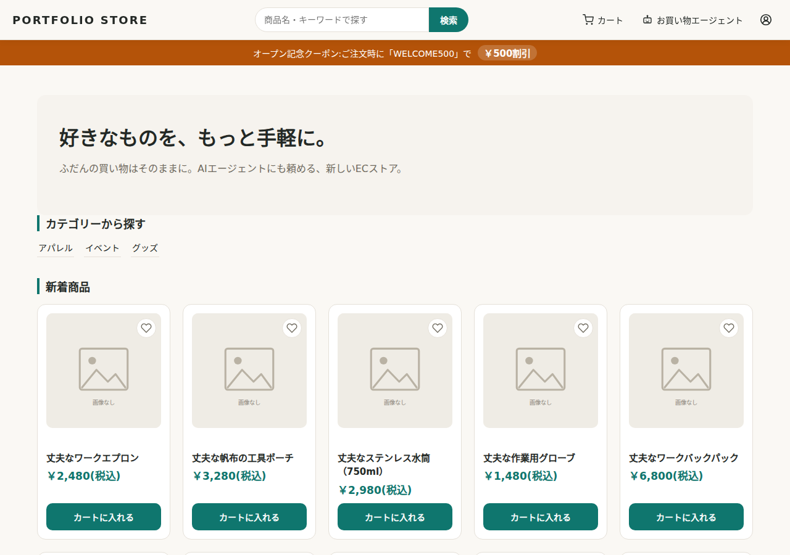
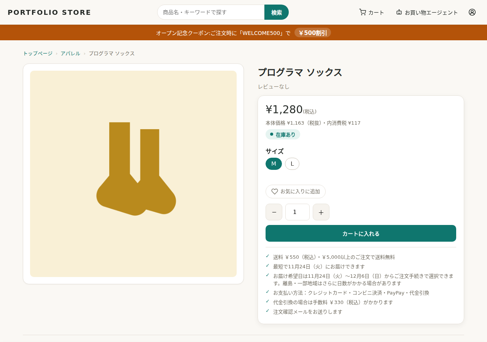
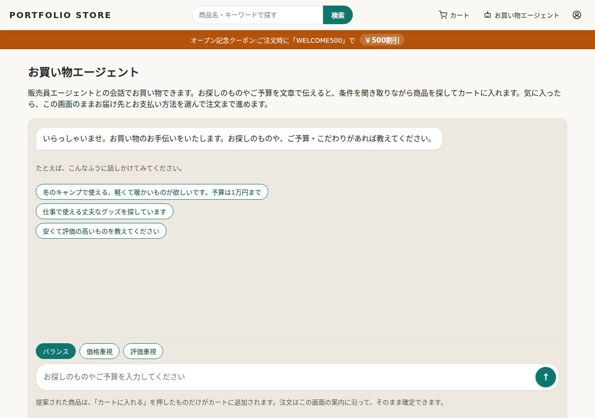
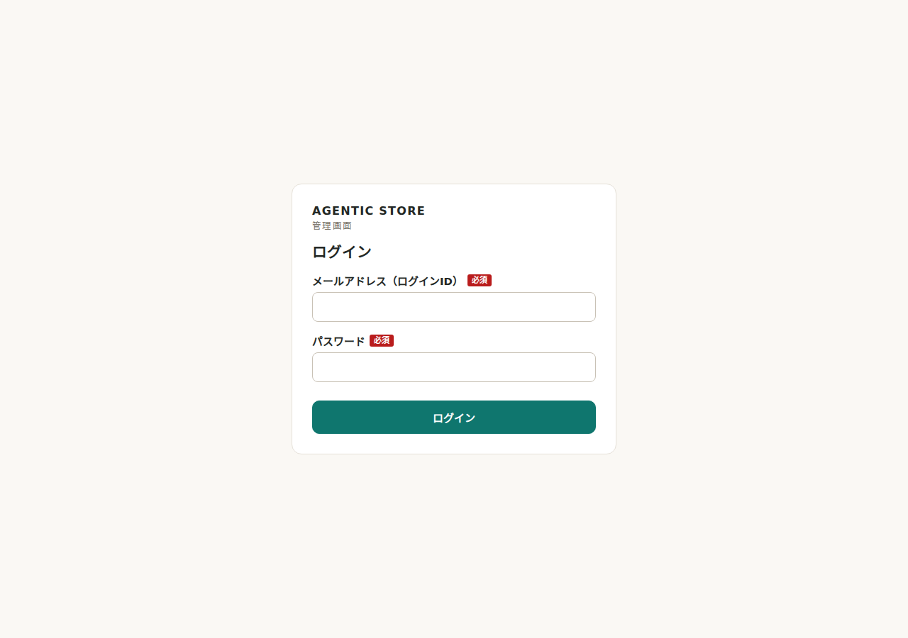
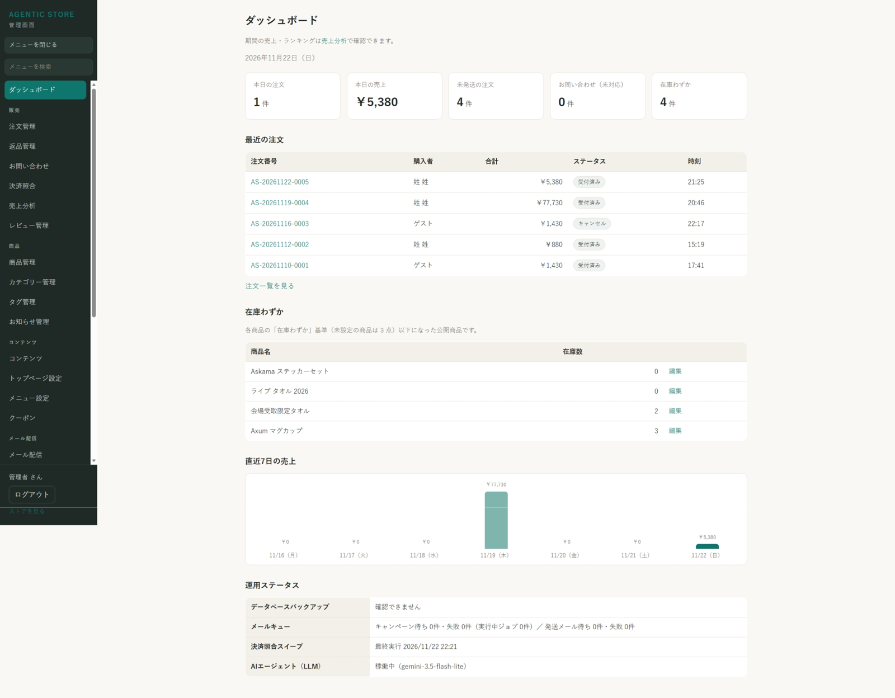

[日本語](README.md) | English

> The [Japanese README](README.md) is the canonical text. This English version is maintained alongside it; if the two differ, the Japanese text prevails.

# Kaimoru

[](#licence)
[](#stack)
[](https://ik1-104-58605.vs.sakura.ne.jp)

A full-stack, server-side-rendered e-commerce store for Japan,
built with Rust and Axum - covering domestic payments (cards,
konbini and PayPay via KOMOJU and Stripe), shipping,
consumption-tax classes, a points programme and step mail.
It is the first full-stack, server-rendered Rust
e-commerce implementation built complete for Japan.

The design starts from **agentic**: a normal human storefront
today, with a conversational shopping agent built in (see "How
the shopping agent works"), and a machine-readable layer planned
so that external AI agents can discover products, compare them,
build a cart and check out with explicit human approval
(inspired by the ACP / UCP / AP2 agentic commerce protocols —
"inspired by", not full protocol compliance).

Built as a portfolio project by a Java/Spring and C#/.NET engineer
moving deeper into Rust and AWS.

## Live demo

A running demo store is available at https://ik1-104-58605.vs.sakura.ne.jp

An admin-page demo is available on request - email basnetstafan@gmail.com for the login information (credentials are never published in this repository).

## Quick start

```bash
cp .env.example .env   # replace the four required values (DB_PASSWORD / APP_DB_PASSWORD / VERIFICATION_CODE_SECRET / PII_ENCRYPTION_KEY) with your own
./run.sh               # starts the database and Mailpit, applies migrations and seed data, serves the store
```

Then open http://localhost:3000. The full prerequisites and the
long-form setup are under "Prerequisites" and "Run it locally"
below.

## Built for Japan, specifically

The parts a generic platform leaves to plugins or workarounds,
implemented in the core:

- **Consumption-tax classes per product** — standard rate,
  reduced rate (軽減税率), exempt and out of scope, with the tax
  amount and the applicable class shown on prices and receipts.
- **Qualified invoices** — set the shop's registration number
  and it is printed on receipts (適格請求書).
- **Domestic payments** — KOMOJU (cards, konbini, PayPay) plus
  Stripe as a config-selected second rail, and cash on delivery.
- **Delivery conventions** — delivery date and time-slot
  selection at checkout.
- **Addresses and sign-up, the Japanese way** — postal-code
  address lookup, and a registration flow built around a
  six-digit code sent by email.
- **Points and step mail** — a points programme (earned at
  shipment, expiry per grant) and step mail with welcome and
  review-request scenarios.
- **Reviews only after delivery** — a review can be posted only
  by a member whose order has actually been delivered.

## Stack

| Area | Technology |
|---|---|
| Language | Rust (edition 2024, toolchain 1.99.1 pinned in `rust-toolchain.toml`) |
| Web framework | Axum 0.8 / Tokio |
| Database | PostgreSQL 16 (sqlx, 44 migrations) |
| Templates | Askama (server-side rendering) |
| Frontend | htmx + plain JavaScript (self-hosted, no build step) |
| Sessions | tower-sessions (PostgreSQL backend) |
| Mail | lettre (Mailpit locally, Amazon SES in production) |
| Local infrastructure | Docker Compose |

## Screenshots

Actual screens from the live demo (Portfolio Store).



Top page: new arrivals and category navigation.



Product detail: tax-inclusive price with the tax breakdown, variant selection, delivery-date guidance.



The shopping agent: describe what you need in conversation and receive proposals. The priority (balanced / price-first / ratings-first) is selectable.



The admin login.



Admin dashboard — today's orders and sales, unshipped orders, low stock, the last 7 days of sales, and operational status on one screen.

## What works today

- Storefront: top page (new arrivals, Top-5 sales ranking, event row,
  category navigation), product search with htmx
  suggestions (PostgreSQL `pg_trgm`), product detail pages.
- Product variants: free-form variation axes (サイズ, カラー, 容量 —
  any heading with up to 5 options, defined per product in the admin),
  with stock held per combination. The detail page and the listing
  cards' quick-add modal share one picker; a product's displayed
  stock is the sum of its combinations.
- Accounts: Japanese-style sign-up — email → 6-digit verification code
  (HMAC-SHA-256 hashed, DB-enforced attempts/expiry) → member details →
  confirmation. Argon2id password hashing, login throttling, timing
  equalization for unknown emails.
- Cart & checkout: htmx cart with a guest/member split (guest carts are
  keyed by a session token, merged on login, re-keyed on sign-up),
  one coupon per order, cash-on-delivery and hosted gateway payments
  (KOMOJU, plus Stripe as a config-selected second rail), one-transaction order
  placement with row locks and price snapshots, order history on
  マイページ. Cart lines are per combination (two sizes of one product
  are two lines), and each order line snapshots its combination's
  label (e.g. `サイズ: L / カラー: ブラック`).
- Sessions: `tower-sessions` on PostgreSQL. The session record holds
  only the user ID (plus transient flow state); the cart lives in its
  own table. In-memory state is used only for disposable counters.

## How the shopping agent (beta) works

The storefront ships with a shopping agent you talk to in plain
language (try it at `/agent` on the live demo).

1. **Say it in words.** "Something light and warm for winter
   camping, up to ¥10,000" — describe what you are looking for
   in a sentence.
2. **The agent builds a brief.** From the conversation it
   assembles the conditions: a budget, a category, must-have
   attributes, and a priority — balanced, price-first, or
   ratings-first. If something essential is missing it asks, at
   most twice in a row, then searches with what it has.
3. **A deterministic engine does the searching.** Matching and
   ranking run against the live catalog. Product names, prices
   and stock come from the engine's output — the language model
   never states product facts — and every proposal carries its
   reason.
4. **Only approved items enter the cart.** A proposed product
   is added only when you press "add to cart", and lines the
   agent placed are marked as agent-placed. A candidate that
   would break the budget is shown separately, with the overage
   stated — it is never added silently.
5. **Placing the order needs your approval.** Address and
   payment are chosen on the same screen, along the agent's
   guidance, and the order can be placed only from the final
   confirmation step of an approval you explicitly granted.
   Starting a new consultation voids every pending approval.

Points: orders placed through the agent still earn points, but
points cannot be spent on them — spending points is a path of
the regular checkout.

Implementation notes: an LLM interprets the conversation (an
OpenAI-compatible chat API — local Ollama by default in
development; a cloud endpoint can be configured). The model's
only job is turning messages into brief updates; it never
touches product facts. The machine-readable layer for
agent-to-agent commerce (ACP/UCP-inspired catalog and checkout
APIs) is planned, not built — see "Current limitations".

## Production-ready by design

Kaimoru is not a tutorial project with a checkout button attached.
The claim is narrower, and checkable: this code runs in
production today — the live demo above is the instance (a 1 GB
VPS, behind HTTPS, payments in test mode) — and it is held to
that standard by 301 unit-test cases, 55 end-to-end suites, and
44 migrations that are never edited once applied.

- **Layered, one direction only.** Routes -> controllers ->
  services -> repositories -> models. Business rules live in the
  service layer, SQL lives in repositories, and nothing reaches
  around the layer in front of it.
- **Payments that expect failure.** Gateway calls are idempotent,
  every payment record keeps its provider, and a periodic
  reconciliation pass matches local state against the gateway's.
  A refund or capture that cannot complete is flagged for
  compensation - never silently dropped.
- **No lost updates.** Orders, stock and points are written under
  optimistic locking and row locks taken in a fixed order, so two
  admins - or a customer and a batch job - cannot overwrite each
  other.
- **Background workers do the unglamorous work.** Mail delivery,
  payment expiry sweeps, points expiry and guest-cart cleanup run
  as supervised workers, not as side effects of someone's page
  view.
- **Security is the default, not a feature.** Argon2id password
  hashing, CSRF tokens on every POST, login throttling, TOTP
  two-factor authentication for admins and members, an admin audit
  trail, and personal data — email addresses, names, postal
  addresses and phone numbers — stored as AES-256-GCM ciphertext,
  with email lookups served by an HMAC blind index. Logs never
  contain emails, addresses or request bodies.
- **Tested like it matters.** 301 unit-test cases, plus 55
  end-to-end suites that drive the running application over HTTP -
  forged webhooks, tampering and concurrency cases included.
  44 migrations are versioned and, once applied, never edited.

## Why Rust

Most e-commerce systems in Japan run on JVM, PHP or Node stacks.
Kaimoru is a deliberate choice of Rust instead:

- **Memory safety without a garbage collector.** The bugs that
  become 3 a.m. incidents - null dereferences, data races,
  use-after-free - are refused at compile time. There is no GC
  pause in the middle of a checkout.
- **One binary.** The whole store compiles to a single native
  binary. No JVM to tune, no interpreter, no application server:
  deployment is copying a file and starting it.
- **Speed.** Compiled to native code, there is no interpreter
  and no JIT warm-up: the store answers at full speed from the
  first request after a restart, and page rendering and the
  background workers run with no runtime in between.
- **A small footprint.** The production store runs comfortably on
  a 1 GB VPS, together with PostgreSQL and the reverse proxy.
- **Money, protected by the type system.** Amounts are `i64` yen
  from the database column to the template. No float ever comes
  near a price, and what guarantees that is the compiler, not a
  code-review checklist.
- **Concurrency without fear.** The workers - mail, payment
  sweeps, points expiry - run concurrently on Tokio. The data
  races that make threaded code something teams avoid in other
  stacks are stopped by the borrow checker before they can exist.

## Design decisions worth knowing

- **Money is integer yen, end to end** (BIGINT columns, `i64` in Rust).
  Floats never touch a price.
- **Security before features**: bound parameters everywhere, CSRF
  tokens on every POST, generic error messages that never reveal
  whether an account exists, and logs that carry request IDs and
  record IDs only — never emails, codes, addresses or bodies.
- **Server-rendered** with Askama templates + self-hosted htmx and
  plain vanilla JavaScript. No JS framework, no CDN, no build step.
- **Layered architecture**: routes → controllers → services →
  repositories → models, one direction only.
- **Stock lives on combinations, never on the product**: variant
  rows are locked `FOR UPDATE` in id order at placement and restocked
  by variant on cancellation; a combination that has been ordered
  cannot be removed in the admin.

## Current limitations

Stated plainly:

- **The machine-readable layer is planned only.** Catalog and
  checkout APIs for external AI agents (ACP/UCP-inspired) are
  not built. What works today is the human-facing chat agent.
- **Stripe is verified in test mode.** The live-mode manual
  pass (3-D Secure, the PayPay handoff, real webhook payload
  shapes) is still to come. The demo store's payments also run
  in KOMOJU test mode.
- **RFM analytics and subscriptions are not built.** They are
  items on the V2 roadmap.
- **Single-store design.** No multi-store or multi-tenant
  support.

## Prerequisites

Install these first, in this order:

- **An OS path**: on Windows, WSL2 with Ubuntu (clone the repo inside
  the Linux filesystem, not under `/mnt/c`); or Linux/macOS natively.
- **Docker with Compose v2** — runs PostgreSQL and Mailpit locally.
  Verify: `docker --version` and `docker compose version`.
- **Rust via rustup** — the repo's `rust-toolchain.toml` pins the exact
  toolchain, and rustup installs it automatically on the first `cargo`
  command, so no version choice is needed. Verify: `cargo --version`.
- **cargo-audit** — used by the quality gate (below), once:
  `cargo install cargo-audit --locked`.
- **git** — to clone the repo.
- **Ubuntu/WSL only**: the system packages the build links against:
  `sudo apt install pkg-config libssl-dev`. Without them, the build
  fails on OpenSSL.
- **Ollama (optional)**: needed only for the shopping-agent chat.
  Install it from the official site and pull the configured model
  (`ollama pull qwen2.5:1.5b-instruct`); `run.sh` tries to start it.
  Without it the app runs normally and only the chat answers with
  its fallback message.

## Run it locally (WSL2 / Linux)

With the prerequisites in place:

```bash
# 1. Create the environment file (replace every change-me value with your own)
cp .env.example .env

# 2. Start
./run.sh
```

`run.sh` loads `.env`, starts the PostgreSQL and Mailpit containers
itself (`docker compose up -d`), waits for the database, then builds
and starts the server — migrations and seed data are applied
automatically at startup. Secrets live only in `.env` (never
committed); `run.sh` fails fast with a clear message when a required
value is missing.

- App: http://localhost:3000
- Mailpit (verification codes land here): http://localhost:8025
- Dev test account: `test@example.com` / `test1234` (created by running
  `bash scripts/ops/setup_test_fixtures.sh` after the first start;
  see the testing guide for the fixture step)

Note: always open the app as `localhost` (not `127.0.0.1`). Browsers keep separate cookie jars per host, so switching hosts mid-test makes the cart and login look lost.

`./stop.sh` stops the server (`./stop.sh db` also stops the database).

## Quality gate and tests

Before committing a change, run the gate:

```bash
./scripts/check.sh
```

`check.sh` runs `cargo fmt --check`, `cargo clippy --all-targets -- -D warnings`,
`cargo test`, `cargo doc` (warnings treated as errors) and
`cargo audit` in one pass.

Beyond that, 55 shell E2E suites in `scripts/tests/` drive the
running application over HTTP. The suite inventory, prerequisites
and case-ID conventions are in the
[testing guide](docs/development/TESTING.md). The 301 unit-test
cases and their execution records are managed in the
[unit test specification](docs/development/UNIT_TEST_SPEC.md).

## Layout

```
server/         binary entry point: logging, bind, graceful shutdown
app/            the web layer (controllers, services, repositories,
                models, views) in a Cargo workspace crate
configuration/  typed config from config.toml (secrets never live here)
resources/      Askama templates (templates/) + self-hosted assets (static/: css/js/images)
migrations/     sqlx migrations, applied at startup
scripts/        quality gate (check.sh), E2E suites (tests/),
                stubs (stubs/), operations scripts (ops/)
docs/           design documents (start at docs/README.md) and screenshots (images/)
```

## Deployment notes

- The rate limits that live in process memory (login throttle,
  sign-up resend counts, review post counts, search suggest
  counts) are PER TASK on ECS: with N tasks running, the
  effective limit is N times the configured one, and a task
  restart resets them. This is accepted for v1 — the limits
  that must be exact (sign-up code attempts and expiry) are
  enforced in the database. Revisit if the task count grows.
- The release binary does not read this source tree: point
  `CONFIG_PATH` at the deployed config file and `STATIC_DIR`
  at the deployed copy of `resources/static` (see `.env.example`).

## Documentation

The [docs index](docs/README.md) (Japanese) is the guided path
through the design documents: the specifications live in
[docs/specs](docs/specs/), and the engineering-practice notes —
including the testing guide — in
[docs/development](docs/development/). Working guidance for AI
agents is in [AGENTS.md](AGENTS.md), and an LLM-oriented index
of the documents is in [llms.txt](llms.txt).

## Where to ask

- **Bugs** → GitHub Issues.
- **Security problems** → never a public issue; use the contact
  in [SECURITY.md](SECURITY.md) (email).
- **Questions, commercial use** → email
  basnetstafan@gmail.com.

## Using Kaimoru in your own work

Kaimoru is built so you can pick it up and judge for yourself
whether it can carry real work — your own service, a client
project, an internal tool.

How to try it: deploy this repository and evaluate it against
your requirements. Run it, and please report what breaks or
what is missing as an Issue. Reports from real use are what
improve this project most.

Use is under the dual MIT / Apache-2.0 licence, including
commercial and client work. Issue reports are a request, not a
condition of use.

## Contributing

Contributions are welcome. The process is in
[CONTRIBUTING.md](CONTRIBUTING.md) (run the quality gate,
`./scripts/check.sh`, before submitting). For larger work,
please claim the issue with a comment before starting, so two
people do not do the same work. The policy for AI-assisted
contributions is also in CONTRIBUTING.md.

## Licence

Licensed under either of

- Apache License, Version 2.0 ([LICENSE-APACHE](LICENSE-APACHE) or
  https://www.apache.org/licenses/LICENSE-2.0)
- MIT license ([LICENSE-MIT](LICENSE-MIT) or
  https://opensource.org/licenses/MIT)

at your option.

Unless you explicitly state otherwise, any contribution intentionally
submitted for inclusion in this project by you, as defined in the
Apache-2.0 license, shall be dual licensed as above, without any
additional terms or conditions.

## How this project is built

The implementation was written mainly through AI-driven
development: design decisions and review are human, and the
code is written and verified together with AI coding agents.
Working guidance for AI agents lives in [AGENTS.md](AGENTS.md);
the policy for AI-assisted contributions is in
[CONTRIBUTING.md](CONTRIBUTING.md).

## Roadmap

Store core and storefront are complete. Next: the agent-readable
layer (`/.well-known` store profile + catalog API),
human-approved agent checkout with a dummy payment token,
RFM analytics, subscriptions, and the AWS deployment.
