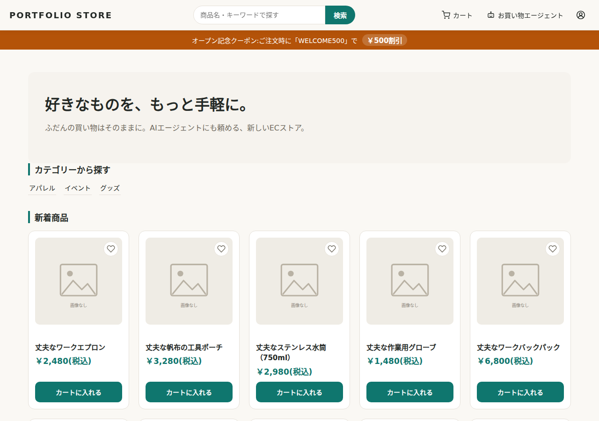
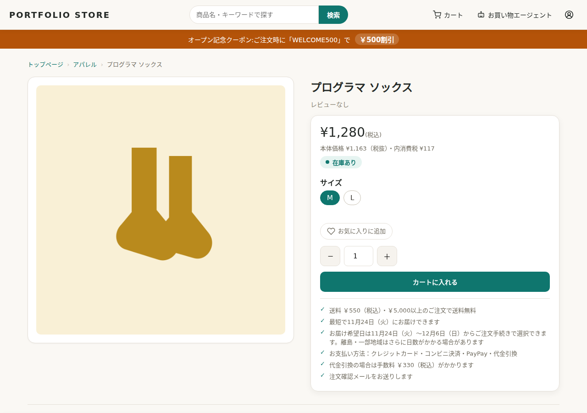
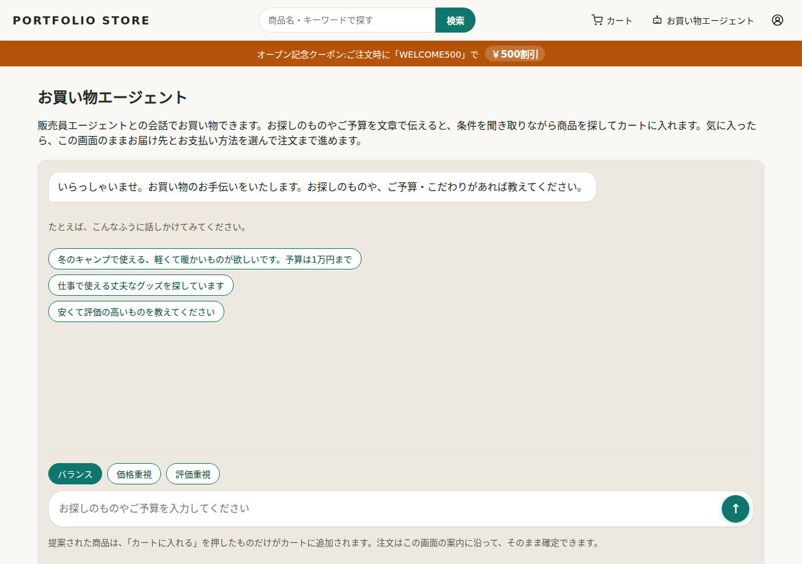
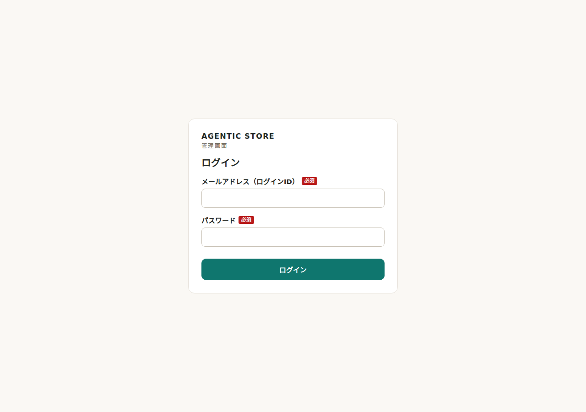
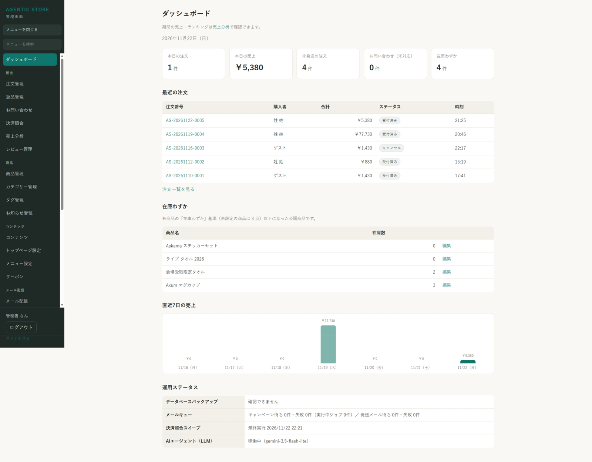

日本語 | [English](README.en.md)

> 本ページ（日本語）が正本です。英語版も併せて維持していますが、差異がある場合は日本語版が優先します。

# Kaimoru（カイモル）

[](#ライセンス)
[](#技術スタック)
[](https://ik1-104-58605.vs.sakura.ne.jp)

Kaimoru は、日本の運用に必要な機能（国内決済・配送・税区分・
ポイント・ステップメールまで）を一通り備えた、フルスタック／
サーバーサイドレンダリング型の Rust 製 EC です。
日本向けに作られた Rust 製 EC の公開実装としては、
初めてのものです。

設計の出発点は「エージェント対応」です。通常の人間向け
ストアフロントと、会話で買い物ができる内蔵お買い物
エージェントに加え、外部の AI クライアント（Claude、
Cursor など）が接続できる MCP サーバーを備えています。
AI はカタログ検索とカート操作ができ、注文は「下書き＋
人間の承認」を経て初めて確定します（「MCP サーバー」参照）。

Java / Spring と C# / .NET のエンジニアが Rust と AWS を深めるための
ポートフォリオプロジェクトです。

## ライブデモ

動作中のデモストアを公開しています: https://ik1-104-58605.vs.sakura.ne.jp

管理画面のデモも用意できます。ログイン情報が必要な方は、メール（basnetstafan@gmail.com）でご連絡ください（認証情報はリポジトリには記載していません）。

## クイックスタート

```bash
cp .env.example .env   # 必須の4値（DB_PASSWORD / APP_DB_PASSWORD / VERIFICATION_CODE_SECRET / PII_ENCRYPTION_KEY）を自分の値に置き換える
./run.sh               # DB と Mailpit を起動し、マイグレーションとシードを自動適用して起動
```

起動したら http://localhost:3000 を開いてください。前提環境と
詳しい手順は「前提環境」「環境構築と起動」にあります。

## 日本向けの機能

汎用プラットフォームではプラグインや運用の工夫で済まされがちな、
日本の商習慣に必要な部分を本体に実装しています。

- **税区分**：標準税率・軽減税率・非課税・不課税を商品ごとに
  設定でき、価格表示と領収書に税額と適用区分を明示します。
- **適格請求書**：店舗の登録番号を設定すれば、領収書に印字します。
- **国内決済**：KOMOJU（カード・コンビニ・PayPay）と、設定で
  切り替える第2レールとしての Stripe。加えて代金引換に対応します。
- **配送**：お届け希望日と時間帯の指定に対応します。
- **住所と登録フロー**：郵便番号からの住所補完と、メールで届く
  6桁の確認コードを使う日本式の会員登録フロー。
- **ポイントとステップメール**：ポイントプログラム（出荷時に付与、
  付与ごとに有効期限）と、ステップメール（ウェルカム／レビュー
  依頼のシナリオ）。
- **レビューは配達完了後**：レビューを投稿できるのは、注文が
  配達完了した会員だけです。

## 技術スタック

| 領域 | 採用技術 |
|---|---|
| 言語 | Rust（edition 2024、ツールチェーン 1.99.1 を `rust-toolchain.toml` で固定） |
| Web フレームワーク | Axum 0.8 / Tokio |
| データベース | PostgreSQL 16（sqlx、マイグレーション51本） |
| テンプレート | Askama（サーバーサイドレンダリング） |
| フロントエンド | htmx + 素の JavaScript（自前ホスト、ビルドステップなし） |
| セッション | tower-sessions（PostgreSQL バックエンド） |
| メール | lettre（ローカルは Mailpit、本番想定は Amazon SES） |
| ローカル基盤 | Docker Compose |

## スクリーンショット

ライブデモ（Portfolio Store）の実際の画面です。



トップページ：新着商品とカテゴリナビ。



商品詳細：税込価格と内消費税の内訳、バリエーション選択、お届け希望日の案内。



お買い物エージェント：会話で条件を伝え、提案を受ける画面。優先順位（バランス／価格重視／評価重視）も選べます。



管理画面のログイン。



管理ダッシュボード。本日の注文・売上、未発送の注文、在庫わずか、直近7日の売上、運用ステータスが一画面に集まります。

## 現在動作する機能

- ストアフロント：トップページ（新着・売上ランキング上位5件・イベント行・
  カテゴリナビ）、PostgreSQL の `pg_trgm` を使った htmx サジェスト付き
  商品検索、商品詳細ページ。
- 商品バリエーション：自由な軸（サイズ、カラー、容量など、見出しごとに
  最大5つの選択肢を管理画面で商品ごとに定義）を持ち、在庫は組み合わせ
  ごとに保持します。
- アカウント：日本式の登録フロー（メールアドレス → 6桁の確認コード
  （HMAC-SHA-256 でハッシュ化し、試行回数と有効期限は DB で強制）→
  会員情報 → 確認）。パスワードは Argon2id でハッシュ化し、ログイン
  試行にはスロットルをかけ、存在しないメールアドレスでも応答時間に
  差が出ないようにしています。
- カートと注文：htmx カート（ゲスト／会員の分離。ゲストカートは
  セッショントークンで識別し、ログイン時に会員のカートへ統合、登録時に会員へひも付け直します）、
  注文ごとにクーポン1枚、代金引換、行ロックと価格スナップショットを
  伴う単一トランザクションでの注文確定、マイページの注文履歴。
- 決済：KOMOJU のホスト型決済（カード・コンビニ・PayPay）に加え、
  Stripe を第2のゲートウェイとして実装済みです。どちらのレールを
  使うかは設定（`hosted_gateway`）で切り替え、決済レコードごとに
  事業者を保持するため、切り替え後も既存決済の照合・返金は元の
  事業者へ振り分けられます。どちらのゲートウェイも使えない場合は
  代金引換のみに縮退します。
- セッション：PostgreSQL 上の `tower-sessions`。セッションレコードが
  保持するのはユーザー ID（と一時的なフロー状態）のみで、カートは
  独自テーブルに置きます。
- MCP サーバー：`/mcp` に公式 Rust SDK（rmcp）製の MCP サーバーを
  内蔵。カタログ検索・商品取得（認証不要）、API キーによるカート
  操作、承認制の注文下書き、注文状況の照会を AI クライアントに
  公開します。OAuth 2.1（Auth0）にも対応。
- RFM 分析：会員の Recency / Frequency / Monetary を五分位で
  バンド化し、管理画面のセグメント条件に使えます。
- コンテンツ：ブログ（予約投稿・RSS・カテゴリ）、記事内から
  直接カートに入れられる商品／カテゴリ埋め込み、ランディング
  ページ。ページは種別（ブログ記事／ランディングページ／
  通常ページ）として一つの管理画面で扱います。

## お買い物エージェント（ベータ版）の仕組み

ストアフロントには、会話で買い物ができる「お買い物エージェント」が
組み込まれています（ライブデモの `/agent` で試せます）。

1. **文章で伝える**：「冬のキャンプで使える、軽くて暖かいものが
   欲しいです。予算は1万円まで」のように、探しているものを
   そのまま文章で伝えます。
2. **条件を聞き取る**：エージェントは会話から条件（ブリーフ）を
   組み立てます。予算、カテゴリ、必須のこだわり、そして優先順位
   （バランス／価格重視／評価重視）です。条件が足りなければ
   続けて2回まで質問し、それ以上は今ある条件で検索します。
3. **実在庫から提案する**：検索と順位付けは決定論的なエンジンが
   担い、ライブカタログに対して条件を照合します。商品名・価格・
   在庫といった事実はエンジンが出力し、言語モデルが商品情報を
   作ることはありません。提案には、それぞれ理由が付きます。
4. **承認したものだけがカートに入る**：提案された商品は
   「カートに入れる」を押したものだけがカートに追加され、
   エージェントが入れた行にはその印が付きます。予算を超える
   候補は、超過額を明示して別枠で示され、黙ってカートに
   入ることはありません。
5. **注文は本人の承認が必須**：お届け先と支払い方法の選択から
   注文確定まで、同じ画面の案内に沿って進みます。注文を確定
   できるのは、提案への明示的な承認を経た最終確認の段階だけ
   です。新しい相談を始めると、未確定の承認はすべて無効に
   なります。

ポイントとの関係：エージェント経由の注文でもポイントは付与
されますが、エージェント経由の注文でポイントを使うことは
できません（ポイント利用は通常のチェックアウトから行います）。

実装について：会話の解釈は LLM が担います（OpenAI 互換の
チャット API。開発環境ではローカルの Ollama が既定で、クラウドの
エンドポイントも設定できます）。モデルの役割は会話をブリーフへの
更新に変換することだけで、商品の事実には触れません。
機械可読レイヤーは MCP サーバーとして実装済みです
（「MCP サーバー」参照）。

## MCP サーバー

`/mcp` に、公式 Rust SDK（rmcp）製の MCP サーバーを同じ
Axum プロセス内に内蔵しています。Claude や Cursor などの
AI クライアントがそのまま接続できます。

- カタログ検索・商品取得・カテゴリ一覧は認証不要で公開
  しています。
- カート操作は、運営者が発行する API キー（スコープ制）が
  必要です。決済はブラウザに引き継ぎ、人間が店舗の画面で
  支払います。
- 注文は承認制です。エージェントは注文の下書きまでしか
  作れず、人間が内容を確認して承認・支払いをして初めて
  注文が確定します。
- OAuth 2.1（認可サーバーは Auth0）にも対応し、Protected
  Resource Metadata による自動発見ができます。

ツール一覧と接続方法は
[MCP サーバーのドキュメント](docs/development/MCP_SERVER.md)
を参照してください。

## 本番運用を前提にした設計

Kaimoru は、チェックアウトボタンだけを付けた学習用プロジェクトでは
ありません。主張は控えめに、確認できる形で書きます。この
コードは実際に本番で動いています——上のライブデモがその
インスタンスです（メモリ 1 GB の VPS、HTTPS、決済はテストモード）。
そして単体テスト361件、E2E スイート62本、適用済みは書き換えない
マイグレーション51本で、その状態を保っています。

- **一方向のレイヤードアーキテクチャ**：routes → controllers →
  services → repositories → models。業務ルールはサービス層に、
  SQL はリポジトリに閉じ込め、層を飛ばした参照はしません。
- **失敗を前提にした決済**：ゲートウェイ呼び出しは冪等で、決済
  レコードごとに事業者を保持します。定期的な照合で自店の状態と
  ゲートウェイ側の状態を突き合わせ、返金や確定が完了できない
  決済は、黙って落とさず補償対象としてフラグを立てます。
- **失われた更新を作らない**：注文・在庫・ポイントの書き込みには
  楽観的ロックと行ロックを使い、管理者同士や、顧客とバッチ処理が
  互いを上書きしないようにしています。
- **裏方の処理はバックグラウンドワーカーが担います**：メール送信、
  決済の期限切れスイープ、ポイント失効、ゲストカートの掃除は、
  誰かの画面表示の副作用ではなく、監督付きのワーカーとして
  動きます。
- **セキュリティは標準装備**：パスワードは Argon2id、すべての
  POST に CSRF トークン、ログインスロットル、管理者と会員向けの
  TOTP 二要素認証、管理操作の監査証跡。個人情報（メールアドレス・
  氏名・住所・電話番号）は AES-256-GCM で暗号化して保存し、
  メールアドレスの検索には HMAC のブラインドインデックスを
  使います。ログにはメールアドレス・住所・リクエストボディを
  含めません。
- **お金が絡むからこそテストを厚く**：単体テスト361件に加え、
  起動中のアプリを HTTP で叩く E2E スイートが62本。偽造 Webhook、
  改ざん、同時実行のケースも含みます。マイグレーションは51本を
  バージョン管理し、適用済みのものは書き換えません。

## なぜ Rust か

日本の EC は JVM、PHP、Node のスタックが主流です。Kaimoru は、
あえて Rust を選んだ実装です。

- **GC のないメモリ安全性**：ヌル参照、データ競合、解放済み
  メモリの使用といった、深夜の障害になりやすいバグの多くは、
  コンパイル時に弾かれます。チェックアウトの途中で GC の停止が
  入ることもありません。
- **バイナリは1つ**：ストア全体が単一のネイティブバイナリに
  コンパイルされます。JVM のチューニングも、インタプリタも、
  アプリケーションサーバーも要りません。デプロイはファイルを
  置いて起動するだけです。
- **実行速度**：ネイティブコードにコンパイルされるため、
  インタプリタも JIT のウォームアップもありません。起動直後
  から一定の速度で応答し、SSR のページ表示もバックグラウンド
  ワーカーも、余分なランタイムを挟まずに動きます。
- **小さいフットプリント**：本番のストアは、PostgreSQL と
  リバースプロキシと一緒に、メモリ 1 GB の VPS で無理なく
  動いています。
- **金額は型で守る**：金額は DB の BIGINT からテンプレートまで
  `i64` の円で一貫します。価格に浮動小数点数が紛れ込む余地は
  なく、それを保証するのはレビューの注意力ではなくコンパイラ
  です。
- **データ競合のない並行処理**：メール・決済スイープ・ポイント失効
  などのワーカーは Tokio 上で並行に動きます。他のスタックでは
  避けられがちなスレッド間のデータ競合は、借用チェッカーが
  起こる前に止めます。

## 設計上の判断

- **金額は整数の円で一貫させています**（DB は BIGINT、Rust は `i64`）。
  価格に浮動小数点数は一切触れさせません。
- **機能よりセキュリティを先に**：すべてのクエリでバインドパラメータ、
  すべての POST に CSRF トークン、アカウントの存在を明かさない
  汎用エラーメッセージ、メールアドレス・確認コード・住所・リクエスト
  ボディを含まないログ（リクエスト ID とレコード ID のみ）。
- **サーバーレンダリング**：Askama テンプレート＋自前ホストの htmx と
  素の JavaScript。JS フレームワーク、CDN、ビルドステップはありません。
- **レイヤードアーキテクチャ**：routes → controllers → services →
  repositories → models の一方向のみ。
- **在庫は商品ではなく組み合わせに置きます**：注文確定時はバリエーション
  行を ID 順に `FOR UPDATE` でロックし、キャンセル時はバリエーション
  単位で戻します。一度注文された組み合わせは管理画面から削除できません。

## 現在の制限

正直に書いておきます。

- **ACP / UCP への完全準拠はうたっていません**：機械可読
  レイヤーは MCP サーバーとして実装済みですが、ACP / UCP /
  AP2 への準拠ではなく、各プロトコルに着想を得た形です。
- **Stripe はテストモードで検証済みです**：本番モードでの手動
  確認（3D セキュア、PayPay 連携、実際の Webhook の形状）は
  これからです。ライブデモの決済も KOMOJU のテストモードで
  動いています。
- **定期購入は未実装です**：V2 ロードマップの項目で、
  まだ作っていません。
- **単一店舗の設計です**：複数店舗・マルチテナントには対応
  していません。

## 前提環境

次の順序でインストールしてください。

- **OS**：Windows の場合は WSL2 + Ubuntu（リポジトリは Linux
  ファイルシステム内に clone し、`/mnt/c` 配下には置かないこと）、
  または Linux / macOS を直接使います。
- **Docker と Compose v2**：PostgreSQL 16 と Mailpit をローカルで
  動かします。確認コマンドは `docker --version` と
  `docker compose version` です。
- **Rust（rustup 経由）**：`rust-toolchain.toml` がツールチェーン
  1.99.1 を固定しており、最初の `cargo` コマンドで自動的に
  インストールされます。確認コマンドは `cargo --version` です。
- **cargo-audit**：品質ゲート（後述）で使います。
  `cargo install cargo-audit --locked` で一度だけインストールします。
- **git**：リポジトリの clone に使います。
- **Ubuntu / WSL のみ**：ビルドがリンクするシステムパッケージ
  `pkg-config` と `libssl-dev` が必要です
  （`sudo apt install pkg-config libssl-dev`）。無いと OpenSSL の
  リンクでビルドが失敗します。
- **Ollama（任意）**：ショッピングエージェントのチャット機能にのみ
  必要です。公式手順でインストールし、`ollama pull qwen2.5:1.5b-instruct`
  でモデルを取得してください（`run.sh` が起動を試みます）。無い場合も
  アプリは動作し、チャットだけがフォールバック応答になります。

## 環境構築と起動

前提環境が揃ったら、次の手順で起動します。

```bash
# 1. 環境変数ファイルを用意する（change-me の値をすべて自分の値に置き換える）
cp .env.example .env

# 2. 起動する
./run.sh
```

`run.sh` は `.env` を読み込み、PostgreSQL と Mailpit のコンテナを
起動し（`docker compose up -d`）、DB の接続を待ってからサーバーを
ビルドして起動します。マイグレーションとシードデータは起動時に
自動で適用されます。秘密情報は `.env` のみに置き（コミットされません）、
必須値が欠けている場合は明確なメッセージで即座に失敗します。

- アプリ：http://localhost:3000
- Mailpit（確認コードの受信箱）：http://localhost:8025
- 開発用テストアカウント：`test@example.com` / `test1234`（初回起動後に
  `bash scripts/ops/setup_test_fixtures.sh` を実行すると作成されます。
  手順の詳細は[テストガイド](docs/development/TESTING.md)参照）

注意：アプリは必ず `localhost` で開いてください（`127.0.0.1` では
ありません）。ブラウザはホストごとに Cookie を分けて保持するため、
途中でホストを切り替えるとカートやログインが消えたように見えます。

停止は `./stop.sh`（`./stop.sh db` で DB コンテナも停止）です。

## 品質ゲートとテスト

変更をコミットする前に、必ずゲートを通してください。

```bash
./scripts/check.sh
```

`check.sh` は `cargo fmt --check`、`cargo clippy --all-targets -- -D warnings`、
`cargo test`、`cargo doc`（警告をエラーとして扱う）、`cargo audit` を
一括で実行します。

このほか、起動中のアプリに対して HTTP 経由で検証するシェル製の
E2E スイート（62本）が `scripts/tests/` にあります。スイートの一覧・
前提条件・ケース ID の規約は
[テストガイド](docs/development/TESTING.md)にまとめています。
単体テストは365件あり、一覧と実施記録は
[単体試験仕様書](docs/development/UNIT_TEST_SPEC.md)で管理しています。

## プロジェクト構成

```
server/          バイナリのエントリポイント：ログ、バインド、グレースフルシャットダウン
app/             Web 層（controllers / services / repositories / models / views / middleware / util）
configuration/   config.toml からの型付き設定（秘密情報はここに置かない）
resources/       Askama テンプレート（templates/）と自前ホストのアセット（static/：css / js / images）
migrations/      sqlx マイグレーション（起動時に適用）
scripts/         品質ゲート（check.sh）、E2E スイート（tests/）、スタブ（stubs/）、運用スクリプト（ops/）
docs/            設計ドキュメント（入口は docs/README.md）とスクリーンショット（images/）
```

## ドキュメント

[ドキュメント索引](docs/README.md)が全体の入口です。仕様書は
[docs/specs](docs/specs/)、開発プラクティスやテストガイドは
[docs/development](docs/development/)にあります。
AI エージェント向けの作業ガイドは [AGENTS.md](AGENTS.md)、
LLM 向けのドキュメント一覧は [llms.txt](llms.txt) にあります。

## サポートの窓口

- **不具合の報告**：GitHub Issues へお願いします。
- **セキュリティ上の問題**：公開 Issue にはせず、
  [SECURITY.md](SECURITY.md) の連絡先（メール）へご連絡ください。
- **質問・商用利用の相談**：メール（basnetstafan@gmail.com）
  でご連絡ください。

## 実務での利用について

実務の土台として使えるかどうかは、動かしてみるのが一番
確実です。Kaimoru は、そのままデプロイして試せるように
作りました。自社サービスにも、受託案件にも使えます。

要件に合うかどうか確かめてみて、壊れた点や足りない点が
あれば Issue で教えてください。実際に使った方からの報告が、
このプロジェクトを一番成長させます。

ライセンスは MIT / Apache-2.0 のデュアルライセンスで、
商用利用も可能です。Issue での報告は条件ではなく、お願いです。

## コントリビューション

歓迎します。進め方は [CONTRIBUTING.md](CONTRIBUTING.md) に
まとめています（品質ゲート `./scripts/check.sh` を通してから
出してください）。大きめの作業は、二重作業を避けるため、
先に Issue で担当を宣言してから始めてください。AI ツールを
使ったコントリビューションの扱いも CONTRIBUTING.md に
記載しています。

## ライセンス

本プロジェクトは以下のいずれかのライセンスで提供されます（あなたの選択）。

- Apache License, Version 2.0（[LICENSE-APACHE](LICENSE-APACHE) /
  https://www.apache.org/licenses/LICENSE-2.0）
- MIT license（[LICENSE-MIT](LICENSE-MIT) /
  https://opensource.org/licenses/MIT）

あなたが明示的に別途表明しない限り、Apache-2.0 ライセンスで定義される
「あなた」によって本プロジェクトへの組み込みを意図して提出された
コントリビューションは、上記のデュアルライセンスが追加の条件なしに
適用されるものとします。

## 開発について

本プロジェクトの実装は、主に AI 駆動開発で進められました。
設計と判断、レビューは人間が担い、実装と検証は AI コーディング
エージェントと協働しています。AI エージェント向けの作業ガイドは
[AGENTS.md](AGENTS.md) に、AI ツールを使ったコントリビューションの
扱いは [CONTRIBUTING.md](CONTRIBUTING.md) にまとめています。

## ロードマップ

ストアのコアとストアフロントは完成しています。次は定期購入
（サブスクリプション）と AWS へのデプロイ、そして MCP の
実クライアントでの検証です。
